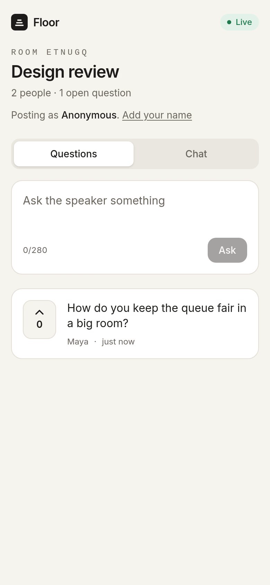
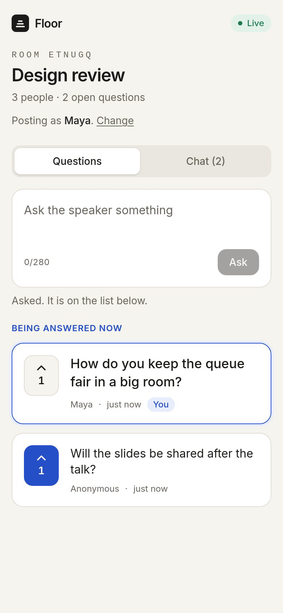
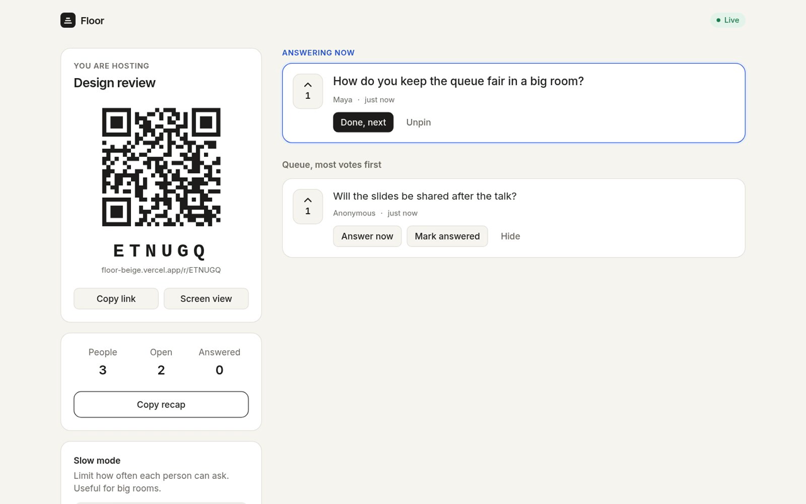
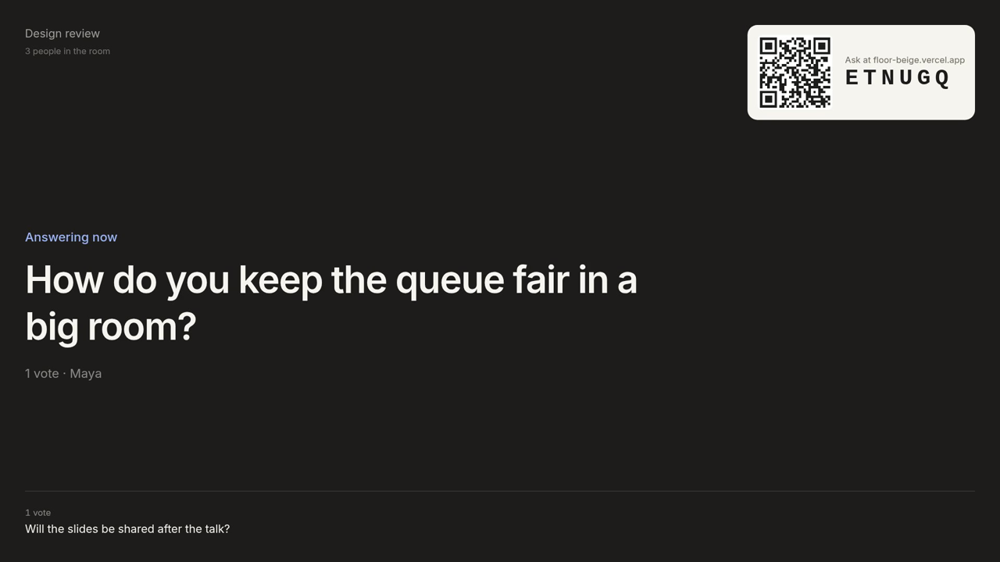

# Floor: live audience Q&A on Nexconn

Nexconn Build Challenge 2026 submission

- Live app: <https://floor-beige.vercel.app>
- Source: <https://github.com/Joe-Simo/floor>
- Nexconn App Key: `8brlm7uf89gq3` (app "Floor", North America data center)
- Demo video: VIDEO LINK GOES HERE (Vimeo)

## Why Floor exists

Every all-hands, meetup, lecture and conference panel ends the same way: "Any questions?", then silence, or the same two people at the microphone. The questions most of the room wants answered never get asked, because asking means standing up in front of everyone.

The tools that fix this today ask too much. Attendees have to install an app or make an account, hosts have to set up an event in advance, and the free tiers cap the audience. So most small events just skip it.

Floor takes ten seconds. The host types a title and gets a six character code and a QR code. Anyone in the room scans it on their phone and can ask, upvote and chat, with no sign up and no install. The best questions rise to the top, the host picks one to answer, and the projector shows it in large type. When the session ends, the host copies a recap.

## What it does

- **Ask without an account.** Attendees join by QR or code. A name is optional, so people can ask anonymously.
- **Upvote, and fewer duplicates.** While someone types, Floor shows similar questions already in the queue and offers "Upvote this" instead, so the queue stays short.
- **Host controls.** Answer now (pins the question for everyone), Done, next, Mark answered, Hide, Unpin.
- **Projector view.** `/r/CODE/screen` shows the question being answered, the next three, and the join QR, sized for a room screen.
- **Slow mode.** For big rooms the host can limit each attendee to one question per 30 seconds, 1 minute or 2 minutes. It is enforced the same way on every client.
- **End session and recap.** Ending freezes the room for everyone. The recap groups similar questions, lists the most wanted, and separates answered from still open. It can be copied as Markdown or downloaded.
- **Side chat** for reactions and links without cluttering the queue.
- **Calm on bad Wi-Fi.** A slim banner says when a device is offline or reconnecting, and Floor reloads history when it is back, so nothing is missed.
- **Mobile first and accessible.** Large touch targets, keyboard support and screen reader labels on every control.

## Screenshots

Real captures of the live app in Nexconn mode, Nov 3, 2026. Names are sample data.

<figure class="phone"><figcaption>A late joiner on a new device sees the question asked before they joined.</figcaption></figure>
<figure class="phone"><figcaption>An attendee phone: the pinned question, votes and the side chat tab.</figcaption></figure>

<figure><figcaption>The host view: join code and QR, the question being answered, and the queue ranked by votes.</figcaption></figure>

<figure><figcaption>The projector view for the room screen.</figcaption></figure>

## How Floor uses Nexconn

Floor has no database. The Nexconn Chat SDK is the whole realtime and storage layer.

- **Group channels.** Each room is a Nexconn group channel named `floor-CODE`. The server creates the channel when the host opens the room and adds each attendee when they join.
- **Custom messages.** Every action (ask, vote, retract, pin, answer, hide, slow mode, end, chat) is one small, persisted custom message of type `floor:evt`. Every client folds the same event log into the same room state. Events are deduplicated by id and sorted by time, so duplicate or out of order delivery is harmless.
- **Remote message history.** When someone joins late or reloads, Floor loads the channel history with `BaseChannel.createMessagesQuery` and replays it, so they see the full room, including votes and the pinned question.
- **Catch-up for late joiners.** Group channels show a new member only messages sent after they joined. A newcomer whose history misses the start of the room sends a non-persisted `floor:sync` request, and the host's client replies with a persisted snapshot of the log. Clients accept snapshots only from the channel owner, and a reload replays the snapshot from the newcomer's own history.
- **Trust in the fold.** Each event must be sent by the user it names (`senderUserId`), and host-only actions are accepted only from the room's host, so an attendee cannot pin or hide by editing their page.
- **Connection status.** The SDK's connection status handler drives the Live, Reconnecting and Offline indicator, and a reconnect triggers a history reload.
- **Server API for identity.** `POST /api/session` issues a Nexconn access token (`/v4/auth/access-token/issue`), creates or joins the group channel, and tells the client its data center (`AreaCode.NA`). Requests are signed with the App Secret on the server only, and fail over to the backup API domain on a timeout or a server error.

Proof from the live deployment on Nov 3, 2026: `/api/session` returns `mode: "nexconn"`, `area: "NA"`, a freshly issued token and the room's channel id (for example `floor-QTDQ27`), and the browser's realtime connection goes to `ws.us-light-edge.com`.

## Testing

- 52 automated tests (Vitest) cover the room model, slow mode, grouping and recap, request signing, API failover, the session endpoint and the message format.
- An end to end run on the live URL with two separate browser contexts (a host and attendees) checks: asking, upvoting, pinning, a late joiner catching up, reloading every view to replay history, and the projector view.

## What existed before the challenge

Nothing. The challenge opened on Oct 23, 2026, and every line of Floor was written during it. The git history shows:

- Oct 26, 2026: first commit, the Q&A app on Nexconn with a demo mode
- Oct 27, 2026: end session, slow mode, grouped recap, offline banner
- Nov 3, 2026: real Nexconn mode on the North America data center, late joiner catch-up, API failover

## Business and growth

- **Free for meetups, classrooms and small teams.** One link, no accounts, no setup.
- **Paid for organizations:** custom branding on the projector view, recap export to docs and slides, moderation (word filters, approve before showing), and session analytics.
- **Built in growth:** every session puts the Floor link and QR code on the room screen, in front of everyone present.
- Every attendee who joins a room becomes an active Nexconn user.

## What is next

- Moderation queue and word filters for public events
- Reactions on the projector view
- Multiple rooms per event, for conference tracks
